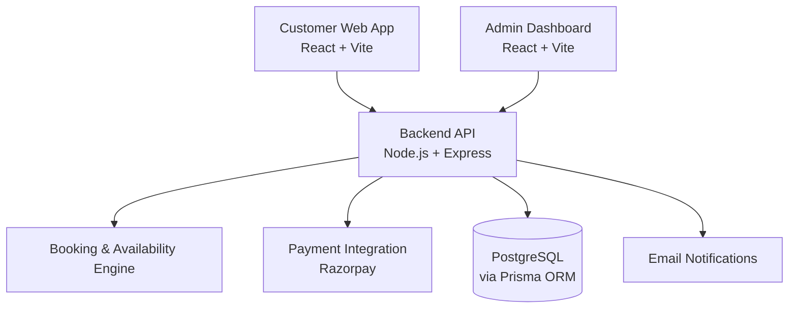

# RideOn — Campus Two-Wheeler Rental Platform

**A full-stack platform for managing campus bike rentals, bookings, payments, and fleet operations.**

RideOn makes two-wheeler rentals easier to manage through a customer-facing booking application, an operations dashboard, and a backend that handles availability, pricing, payments, and booking rules.

I independently developed the platform for a real client, covering the customer experience, administration interface, backend APIs, and core booking workflows.

**Website:** [rideon.website](https://www.rideon.website/)

**Admin Panel:** [Open Admin Panel](https://test-admin.rideon.website/login)

---

## Overview

Traditional rental operations can rely heavily on calls, messaging apps, and manual spreadsheets. This makes it harder to track availability, coordinate bookings, and maintain consistent records.

RideOn brings these workflows into one connected system.

- **For customers:** Check availability, compare pricing, book rides, make payments, and manage bookings.
- **For operations:** Manage bikes, bookings, users, pricing, payments, and rental policies from a dedicated dashboard.
- **For the business:** Keep booking and payment records consistent, reduce manual coordination, and manage rental operations through configurable rules.

The goal is simple: make campus mobility more convenient for customers and easier to operate for the business.

## Product Architecture

RideOn is organized into three main applications that communicate through a shared backend API.



### Customer application

The public-facing application for browsing availability, making reservations, completing payments, and managing bookings.

### Admin dashboard

A separate interface for operational tasks, including fleet management, booking management, pricing, policies, and payment records.

### Backend API

The central layer responsible for authentication, validation, booking rules, availability checks, payment workflows, database operations, and notifications.

Keeping these responsibilities in the backend helps maintain consistent business rules across both interfaces.

## Key Features

### Customer Experience

- Availability checking before booking.
- Alternative time-slot suggestions when a requested slot is unavailable.
- Pricing calculations that account for configured packages and applicable charges.
- Online booking and Razorpay payment integration.
- Booking history and booking details.
- Cancellation based on configured eligibility and fee rules.
- Profile management and supporting information pages.
- Responsive, mobile-first interface.
- Local booking-draft persistence for a limited period.

### Administration and Operations

- Authenticated admin access with role-based permissions.
- Dashboard metrics and recent activity.
- User and fleet management.
- Booking and payment management.
- Pricing configuration and rental policies.
- Configurable GST, platform fees, helmet charges, and other supported rules.
- Context-aware booking actions, including pickup, return, and cancellation.
- Date filters and paginated data views.
- Centralized operational controls through the backend.

### Backend and Business Logic

- Buffer-aware booking availability.
- Same-duration alternative slot suggestions.
- Server-side booking validation.
- Transactional booking creation.
- Razorpay order creation and payment verification.
- Payment webhook processing.
- Booking and payment status synchronization.
- JWT-based authentication and refresh-token handling.
- Magic-link-style verification.
- Cancellation rules and fee calculations.
- Transactional email notifications.
- Configurable system settings.

## The Availability Engine

One of the central engineering challenges in RideOn is deciding whether a bike can be booked for a particular time window without conflicting with existing reservations.

The availability engine applies business rules on the backend rather than relying on frontend checks alone.

### How it works

1. **Check existing bookings.** Identify reservations in blocking states, including `PAYMENT_PENDING`, `CONFIRMED`, and `ACTIVE`.
2. **Apply buffer periods.** Account for the configured turnaround buffer around bookings when evaluating overlapping time windows.
3. **Respect fleet status.** A bike marked `AVAILABLE` or `IN_USE` may still be eligible for a future booking if the requested window satisfies the availability rules.
4. **Suggest alternatives.** If the requested slot is unavailable, search in 30-minute increments for nearby alternatives of the same duration, returning up to five suggestions, nearest first.
5. **Validate during booking creation.** Recheck availability inside a serializable database transaction and assign a specific bike.
6. **Reject invalid pickup times.** Prevent bookings in the past, allowing a small five-minute grace period for clock skew.

### Why this matters

Checking availability only in the browser is not enough. Two customers can request the same bike at nearly the same time.

RideOn performs a fresh availability check during booking creation, using a serializable transaction to help prevent conflicting reservations under concurrent requests.

This approach strengthens consistency between the availability shown to customers and the bookings stored in the database.

## Payment Workflow

RideOn integrates Razorpay to support online payments associated with bookings.

The workflow includes:

- Payment order creation.
- Server-side payment verification.
- Webhook processing.
- Payment status updates.
- Synchronization between payment and booking records.
- Handling payment outcomes as part of the booking lifecycle.

The backend is responsible for validating payment results rather than treating a frontend success message as sufficient proof of payment.

## Technology Stack

| Layer                | Technologies                                        |
| -------------------- | --------------------------------------------------- |
| Customer application | React 19, Vite, Tailwind CSS 4, React Router, Axios |
| Admin dashboard      | React, Vite, Tailwind CSS                           |
| Backend              | Node.js, Express.js                                 |
| Database             | PostgreSQL                                          |
| ORM                  | Prisma                                              |
| Authentication       | JWT, HTTP-only refresh cookies, bcrypt              |
| Payments             | Razorpay                                            |
| Email                | Nodemailer / Brevo                                  |
| Validation           | Zod                                                 |
| Logging              | Pino                                                |

## Design and Engineering Principles

**Backend as the source of truth**

Availability, pricing, booking validation, and payment-related business rules are handled by the backend.

**Transactional booking operations**

Availability is checked again when creating a booking, helping protect against conflicting reservations.

**Configurable business rules**

Supported operational settings, such as booking buffers and pricing policies, can be changed through system configuration where implemented.

**Separation of responsibilities**

The customer app and admin dashboard are separate interfaces that use the same backend API.

**Clear customer feedback**

Customers receive availability information, alternative slots, pricing details, and booking status rather than relying on manual confirmation alone.

**Operational maintainability**

The platform provides dedicated interfaces for routine fleet and booking operations instead of requiring every task to be handled manually.

## Repository Structure

```text
rideon/
├── client/       # Customer-facing application
├── admin-ui/     # Operations and management dashboard
├── server/       # Backend API and business logic
├── docs/         # API documentation and technical notes
└── README.md
```

Each application has its own dependencies and development workflow. Refer to the relevant package scripts and environment examples in the repository for the exact commands and configuration.

## Local Development

### Prerequisites

- Node.js 18 or a compatible version required by the project.
- PostgreSQL.
- npm.
- Razorpay credentials for payment testing.
- Email provider credentials for notification testing.

### 1. Clone the repository

```bash
git clone https://github.com/ShahidKollam/RideOn-Client.git
cd RideOn-Client
```

### 2. Set up the backend

```bash
cd server
npm install
```

Configure the environment variables using the project's `.env.example`, if present.

Then run the applicable Prisma generation, database migration, and seed scripts defined in `server/package.json`.

Start the backend using the development script provided by the project.

### 3. Set up the customer application

Open a separate terminal:

```bash
cd client
npm install
```

Configure the backend API base URL using the environment variable expected by the application, then start the development server using the available npm script.

### 4. Set up the admin dashboard

Open another terminal:

```bash
cd admin-ui
npm install
```

Configure the API URL and start the dashboard using its available npm script.

**Note:** Confirm the actual repository directory names, npm scripts, database setup, and environment-variable names before publishing these instructions. Commands and configuration may differ between versions.

## Environment Configuration

The backend may require configuration for the following areas:

| Variable or setting    | Purpose                              |
| ---------------------- | ------------------------------------ |
| `DATABASE_URL`         | PostgreSQL connection                |
| `JWT_ACCESS_SECRET`    | Access-token signing                 |
| `JWT_REFRESH_SECRET`   | Refresh-token signing                |
| `RAZORPAY_KEY_ID`      | Razorpay integration                 |
| `RAZORPAY_KEY_SECRET`  | Server-side Razorpay operations      |
| Email configuration    | Transactional notifications          |
| Booking buffer setting | Turnaround time between reservations |

These names are illustrative of the documented configuration. The server's actual environment example is the source of truth for the exact variable names.

**Never commit real API keys, database credentials, token secrets, or production environment files.**

## API Overview

The backend uses an API structure based on `/api/v1`.

Main functional areas include:

- **Authentication:** Login, token refresh, verification, and profile operations.
- **Bookings:** Availability checks, creation, listing, cancellation, pickup, and return.
- **Fleet and configuration:** Bikes, campuses, pricing, and policies.
- **Payments:** Order creation, verification, and payment status.
- **Administration:** Protected management operations with role-based access control.

Refer to the project's documentation for the actual endpoints and request/response schemas.

## Project Status

RideOn has been developed for real-world rental operations and is being iterated as the product evolves.

The core workflow connects availability checking, booking creation, payment processing, and operational management. Current deployment status and feature availability may differ by application version.

## Developer

**Shahid M.** — Independent Full-Stack Developer

I independently developed RideOn, working across the customer-facing application, administration dashboard, backend services, and core rental workflows.

The project gave me practical experience in building a complete business application, implementing time-dependent booking rules, integrating payments, and connecting customer and operational workflows through a shared backend.

- **Website:** [rideon.website](https://www.rideon.website/)
- **GitHub:** [RideOn Repository](https://github.com/ShahidKollam/RideOn-Client)

## License

RideOn is a private/proprietary client project unless otherwise stated. Public repository visibility does not automatically grant permission to reuse, redistribute, or commercially exploit its code. Contact the project owner for licensing or collaboration enquiries.

---

*RideOn — making campus mobility simple, reliable, and digital.*
